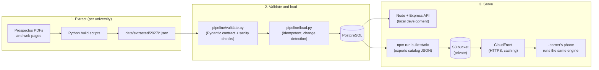

# SAMATRIC

Which South African university courses does a matric learner qualify for?

A learner enters their marks once. SAMATRIC works out their admission score the way **each of the 26 public universities** does, checks every course's subject requirements, and shows what they qualify for, what is within reach, and exactly what to improve.

**Live demo:** https://d1jyytbz9yqcuv.cloudfront.net

> **Status: portfolio project, not maintained.** The data covers the 2027 intake (2,124 courses) and will not be updated. Requirements change every year, so always confirm with the university.

---

## What it does

| Feature | Detail |
|---|---|
| Score per university | 26 different scoring rules: 7-point APS, % ÷ 10 (CPUT, Rhodes), sums of percentages (NMU "AS", UCT "FPS", SU "Aggregate"), weighted points (UWC), Life Orientation caps and bonuses (Wits, UFS, UFH) |
| Per-course scoring | Some courses count different subjects or weight them (UCT Science doubles Maths and Physical Sciences; CPUT Engineering counts only 4 subjects) |
| Subject requirements | "Maths 60% **or** Technical Maths 70%", "2 of these 3 subjects", different minimums for Home Language and First Additional Language |
| Results | Qualifies / within reach / confirm with the university / not yet, with the exact gap ("2 points short", "Maths 55%, need 60%") |
| Improve | The smallest set of mark increases that gets the learner into the courses they chose |
| Search | All 2,124 courses, with abbreviations (BCom, LLB, IT) |
| Privacy | Marks never leave the learner's phone: the hosted version runs entirely in the browser |

---

## Architecture



**Key design decisions**

| Decision | Why |
|---|---|
| One JSON file per university, validated against a Pydantic model | Every prospectus is laid out differently; a strict contract catches extraction mistakes before they reach the database |
| Requirements stored as "AND of OR-groups" with a minimum count | Expresses every rule found across 26 prospectuses without special cases in code |
| Scoring rules stored as data (scales, subjects counted, must-count subjects, weights) | Adding a university with a new rule usually means adding data, not code |
| The API's logic lives in one module (`api-core.js`) used by both the server and the browser | The hosted site and local server can't give different answers |
| Static hosting on S3 + CloudFront instead of a server and database | Course data is read-only and changes yearly, so hosting costs almost nothing and nothing can crash in results week |
| Data file name contains a hash of its contents | Browsers and CloudFront cache it for a year but always pick up new data |

---

## Data

| University | Courses | Source |
|---|---|---|
| University of Johannesburg (UJ) | 179 | UJ Undergraduate Prospectus 2027 |
| Walter Sisulu University (WSU) | 68 | WSU Undergraduate Prospectus 2027 |
| University of Pretoria (UP) | 120 | UP Undergraduate Prospectus 2027 |
| Tshwane University of Technology (TUT) | 124 | TUT First Year Course Information 2027 |
| University of KwaZulu-Natal (UKZN) | 70 | UKZN Undergraduate Prospectus 2027 |
| University of Fort Hare (UFH) | 52 | UFH Undergraduate Study Guide 2027 |
| Durban University of Technology (DUT) | 95 | DUT Study Opportunities 2027 |
| University of the Witwatersrand (Wits) | 60 | Wits Grade 12 presentation (2026 intake) |
| Mangosuthu University of Technology (MUT) | 40 | CAO Handbook 2027 |
| University of Zululand (UNIZULU) | 145 | CAO Handbook 2027 |
| Vaal University of Technology (VUT) | 49 | VUT 2027 Minimum Admission Requirements |
| North-West University (NWU) | 240 | NWU 2027 Grade 12 Prospectus |
| University of Limpopo (UL) | 54 | UL Undergraduate Prospectus 2027 |
| Sefako Makgatho Health Sciences University (SMU) | 17 | SMU Prospectus 2026/2027 |
| University of Venda (UNIVEN) | 77 | UNIVEN 2027 Undergraduate Programmes |
| University of Mpumalanga (UMP) | 20 | UMP Undergraduate Programmes brochure |
| University of the Free State (UFS) | 102 | UFS Undergraduate Prospectus 2027 |
| Central University of Technology (CUT) | 45 | CUT programme web pages |
| Sol Plaatje University (SPU) | 18 | SPU Undergraduate Prospectus |
| Nelson Mandela University (NMU) | 119 | NMU Undergraduate Programme Guide 2027 |
| University of Cape Town (UCT) | 94 | UCT Undergraduate Prospectus 2027 |
| Stellenbosch University (SU) | 88 | SU 2027 Undergraduate Prospectus |
| University of the Western Cape (UWC) | 39 | UWC General Admissions Criteria 2027 |
| Cape Peninsula University of Technology (CPUT) | 116 | CPUT Prospectus 2027 |
| Rhodes University (RU) | 15 | RU READY! Undergraduate Prospectus (Mar 2026) |
| University of South Africa (UNISA) | 78 | UNISA qualification pages (partial) |
| **Total** | **2,124** | |

Where a prospectus was unclear, the choice made is recorded in that university's JSON file under `ambiguities`.

---

## Tech stack

| Part | Technology |
|---|---|
| Data pipeline | Python 3.13, Pydantic, psycopg |
| Database | PostgreSQL |
| Engine and API | Node.js 22, Express 5 |
| Frontend | Plain HTML, CSS and JavaScript (no framework, no build step) |
| Tests | Node's built-in test runner (88 tests, incl. each university's worked examples) |
| Hosting | AWS S3 + CloudFront, deployed with one PowerShell script and the AWS CLI |

---

## Run it locally

Full guide: [docs/setup.md](docs/setup.md).

```powershell
# Database
createdb -U postgres samatric
psql -U postgres -d samatric -f database/schema.sql
psql -U postgres -d samatric -f database/seeds/01_subjects.sql
psql -U postgres -d samatric -f database/seeds/02_aps_scales.sql
# (schema.sql already includes every migration; migrations/ is for older databases)

# Config: copy and add your Postgres password (.env is never committed)
Copy-Item .env.example .env

# Load the data
python -m venv .venv
.\.venv\Scripts\Activate.ps1
pip install -r pipeline/requirements.txt
Get-ChildItem data/extracted/2027/*.json -Exclude *.part*.json | ForEach-Object { python -m pipeline.load $_.FullName }

# Run
cd backend
npm install
npm test
npm start                 # http://localhost:5000 (server + database)
npm run build:static      # or build the hosted version into ../dist
npm run preview:static    # and preview it on http://localhost:8080
```

---

## Project layout

```
pipeline/         Python: data contract (models.py), validation, idempotent loader
data/extracted/   One JSON file per university (+ part files merged at load time)
database/         schema.sql, seeds/, migrations/
backend/src/
  aps.js            Score calculation (scales, subjects counted, weights, LO rules)
  eligibility.js    Qualifies / within reach / not eligible, with the gap
  improve.js        Smallest mark increases to qualify
  search.js         Course search with abbreviations
  api-core.js       All API routes as plain functions (shared by server and browser)
  app.js            Express wrapper around api-core.js
  cli/              check.js, build-static.js, preview-static.js
backend/test/     Unit and API tests
frontend/         The page; static-api.js runs api-core.js in the browser
scripts/          deploy.ps1 (build, upload to S3, refresh CloudFront)
docs/             Setup, data model, yearly update guide
```

---

## Docs

| Topic | Doc |
|---|---|
| Install, run, build and deploy | [docs/setup.md](docs/setup.md) |
| Tables, requirement groups, scoring rules, statuses | [docs/data-model.md](docs/data-model.md) |
| Adding a university or a new intake year | [docs/yearly-update.md](docs/yearly-update.md) |

---

## What I learned

1. **The data was the hard part, not the code.** 26 universities publish requirements in 26 formats: scanned tables, flipbooks, web pages, PDFs that block downloads. A strict data contract and recording every judgement call (`ambiguities`) mattered more than any algorithm.
2. **Model the rules as data.** Each new university's scoring quirk (weights, 4-subject counts, LO caps) became a column or a field, not an `if` statement.
3. **Pick the architecture from the workload.** Read-only data that changes once a year doesn't need a server. Moving the engine into the browser took hosting from an estimated R550–900 a month to about R0.
4. **Test against the source.** Where a prospectus printed a worked example, it became a test.

## What I'd do differently

1. Check for existing products first. Late in the project I found an established app covering the same need, with video guides for applicants.
2. Automate extraction earlier: a lot of the data was built by hand-written scripts per university.
3. Use infrastructure as code (Terraform or CloudFormation) for the AWS setup instead of the console.
4. Add CloudFront's flat-rate plan or a WAF rate limit before sharing the link publicly.

---

## Disclaimer

Admission requirements were extracted from each university's published material for the 2027 intake and may contain errors. They are not maintained. Always confirm with the university before applying.
